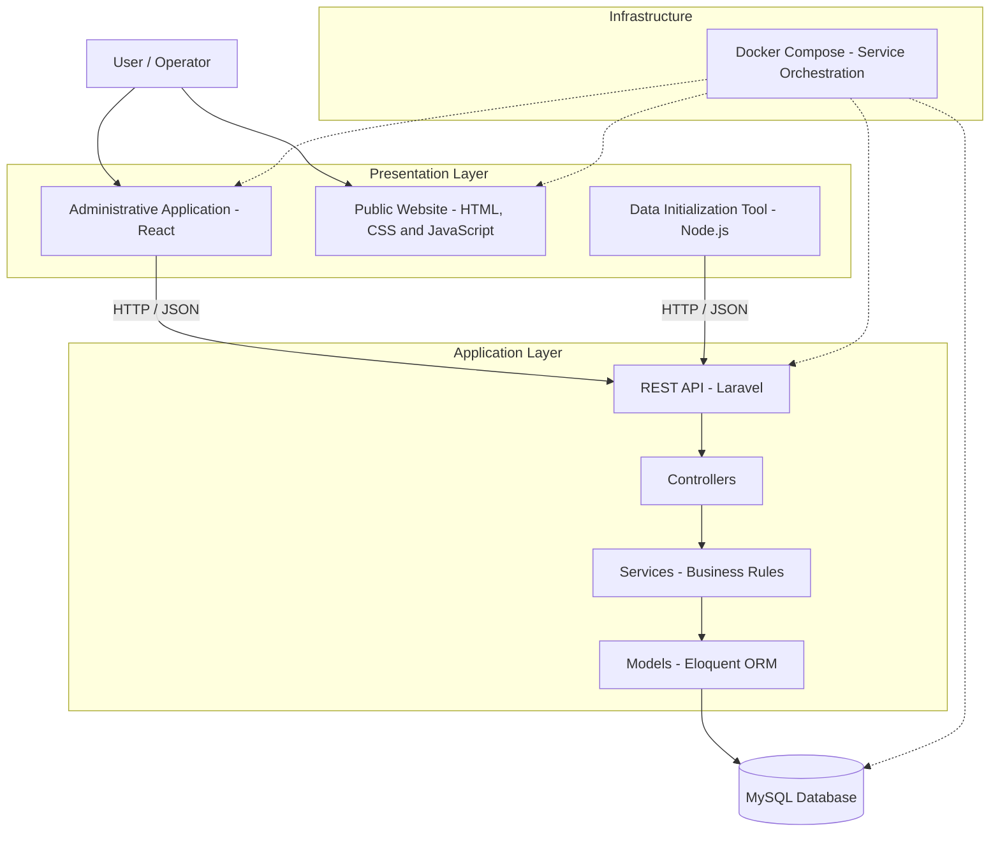

# System Architecture — Music School

**Identifier:** music-school  
**Project:** Musical Instrument Loan Management System  
**Training Group:** ADSO 3239137  
**Apprentice Code:** A12  
**Version:** 1.6
**Status:** Under Review

---

## 1. Purpose

This document describes the technical architecture of the Music School system, establishing the organization of its components, responsibilities, communication mechanisms, and infrastructure distribution.

The architecture defines how the frontend, backend, database, and other components required to manage musical instrument loans and returns will be integrated.

Its design must comply with the principles established in `constitution.md` and the functional requirements, business rules, and non-functional requirements defined in `spec.md`.

## 2. Architectural Objective

Define an organized, maintainable, and secure architecture that enables Music School to be developed using components with independent responsibilities and centralized communication through a REST API.

## 3. Architectural Style

The system will use a client-server architecture with a layered separation of responsibilities.

The following main components will be established:

- **Frontend:** Web application developed with React.
- **Backend:** Application developed with PHP and Laravel.
- **Persistence:** MySQL database.
- **Public Website:** Static page used to present the product.
- **Infrastructure:** Services configured using Docker.
- **Data Initialization Tool:** Data seeding mechanism through the API.

The backend will use a layered organization to separate API presentation, business logic, and data access responsibilities.

## 4. Main Components

### 4.1. Frontend — React

**Technology:** React.

**Responsibility:**

Provide the user interface for interacting with the system's features.

**Main Functions:**

- View and manage the administrative instrument inventory. No separate student-facing catalog view is implemented in the React application.
- Register and manage instrument categories.
- Activate and deactivate categories through the REST API.
- Display the current activation status of categories.
- Register, update, and logically deactivate instruments.
- View available units.
- Manage student information.
- Register loans.
- Register returns.
- View overdue loans.
- View loan and return lists. Per-student loan history is available through the API; the React application has no separate student-history screen.
- View inventory.
- Display the most requested instruments report.
- Display existing inventory, student, active-loan, overdue-loan, and report indicators in the Dashboard.
- Provide local search and filter controls in administrative lists.
- Update permitted instrument and student information through the corresponding API operations.
- Display active and inactive instruments for administration; loan eligibility is determined by backend status and availability checks.

**Implementation Rules:**

- Consume the endpoints defined in `api-contract.md`.
- Send HTTP requests to the backend.
- Display user-facing messages in Spanish.
- Keep presentation logic separate from business rules.
- Do not access the database directly.

Category creation through the API is a previously documented operation, while initialization of the five specified categories is part of the original scope. Manual category creation through React, logical activation/deactivation, and inactive-category restrictions remain scope extensions pending validation. No formal instructor approval is evidenced; the architecture document remains Under Review.

### 4.2. Backend — PHP and Laravel

**Technology:** PHP with Laravel.

**Responsibility:**

Centralize business logic, validate operations, and control data access.

**Main Functions:**

- Manage instruments and categories.
- Control logical category activation and deactivation.
- Prevent category deactivation when associated instruments have pending loans.
- Validate category activation status during instrument registration, instrument updates, and loan registration.
- Preserve existing instruments and historical records when category status changes.
- Manage students.
- Register loans.
- Register returns.
- Control loan due dates.
- Validate inventory availability.
- Preserve historical information.
- Generate the most requested instruments report.
- Control simultaneous operations.
- Provide HTTP and JSON responses.
- Expose read and update operations for students and instruments as documented in the API contract.

**Internal Organization:**

The backend will be organized into the following layers:

**Controllers**

Receive HTTP requests, validate initial input, invoke the corresponding logic, and return responses.

**Services**

Contain business rules and coordinate system operations.

**Models**

Represent entities and enable interaction with persistence through Laravel Eloquent.

**Migrations**

Define database table structures, relationships, and constraints.

**Routes**

Define the endpoints available for communication with the frontend and authorized tools.

### 4.3. Database — MySQL

**Technology:** MySQL.

**Responsibility:**

Store and preserve system information while ensuring data integrity.

**Main Entities:**

- `categories`
- `instruments`
- `students`
- `loans`
- `returns`

**Persistence Responsibilities:**

- Preserve instrument categories.
- Preserve category activation status through the `is_active` field.
- Maintain relationships between categories and instruments regardless of category status.
- Enforce inventory integrity through unsigned quantities and the `chk_instruments_inventory` check constraint.
- Register instruments and their units.
- Store student information.
- Preserve registered loans.
- Register returns.
- Maintain relationships between entities.
- Apply integrity constraints.
- Preserve historical transaction information.

The database structure must correspond to the definitions established in `data-model.md`.

#### Data Access and Schema Management

Laravel will use Eloquent ORM to interact with the MySQL database through models representing the entities defined in `data-model.md`.

Eloquent models will allow the system to retrieve, create, update, and relate entity records, preventing controllers from directly accessing the database.

Laravel migrations will define the physical structure of database tables, their columns, primary keys, foreign keys, constraints, and required indexes.

The main tables will be:

- `categories`
- `instruments`
- `students`
- `loans`
- `returns`

The structure implemented through migrations must remain consistent with the data model documented in `docs/data-model.md`.

Therefore, `data-model.md` documents the conceptual and logical models and their correspondence with the physical model. Laravel migrations materialize and maintain the physical schema in MySQL.

### 4.4. Static Public Website

**Technology:** Static web technologies.

**Responsibility:**

Present the Music School product through an informative public website.

The page must describe the system's purpose and main features.

It will not replace the functional application or perform loan or return operations.

### 4.5. Infrastructure — Docker

**Technology:** Docker and Docker Compose.

**Responsibility:**

Enable the integrated execution of the services required by the project.

The infrastructure will include:

- Backend service.
- Frontend service.
- MySQL database service.
- Service or configuration required to display the static public website.

The infrastructure also includes an independent `api-test` service enabled through the `testing` profile.

This service uses the `music_school_test` database to execute automated and concurrency tests without modifying the main `music_school` database.

Services must be configured to start with a single command, according to the deployment requirement.

### 4.6. Data Seeding Tool

**Responsibility:**

Facilitate the initialization of test data through API endpoints.

The tool must prepare the data required to validate system features without directly modifying the database outside the established mechanisms.

The initial data must include the five instrument categories defined in `spec.md`.

The tool initializes the five specified categories and sample instruments through the API. This original-scope initialization is distinct from category creation through the API as a general operation and from manual category creation in the React administration view. Manual React creation and category lifecycle operations remain scope extensions pending validation.

### 4.7. Dashboard and Administrative Presentation

The Dashboard is a React presentation component. It consolidates responses from the instrument, student, loan, overdue-loan, and report APIs. It displays instrument and student counts, total and available-unit aggregates, active and overdue loan counts, an availability percentage, and the most-requested-instruments ranking with visual bars.

These indicators do not create independent business rules. Eligible units available for new loans are the `available_units` of instruments whose instrument and category are active. Inactive records may retain physically unloaned units, which remain part of total physical inventory but are not eligible for new loans. Each loan represents one physical unit: loan registration decreases availability by one and return registration restores one. Under the inventory-integrity rules, pending loans correspond to units currently on loan. The Dashboard and inventory view use the same eligible-availability criterion; the percentage uses eligible available units divided by total physical units, and displays zero when the total is zero. Manual observations of nonempty inventory states are recorded in `docs/evidence/availability-validation.md`; the zero-total guard is documented from source inspection and was not manually exercised.

RNF-01 requires backend validation to prevent unauthorized modifications or inconsistent data, secret management through environment variables, and secure password hashing when applicable. Laravel input and business-rule validation, database constraints, transactions, concurrency locks, environment-based configuration, and password hashing are implemented. The current API routes have no authentication or role-based authorization mechanism. The academic interpretation of “unauthorized modifications” remains pending validation; no authentication or role feature is inferred from RNF-01.

Administrative React views provide local searches and filters for the records returned by the API. These controls affect presentation only and do not change API routes or backend rules.

### 4.8. Maintenance Support and Framework Scaffolding

`infra/backup.ps1` invokes `mysqldump` through the running Docker Compose MySQL service and writes a timestamped SQL export under `infra/backups/`. It must be run from the `infra/` directory with the Compose environment configured and the MySQL service running. It does not implement restoration, recovery validation, or an automated recovery process.

Laravel's default `users`, password-reset, session, cache, and queue tables, model scaffolding, web welcome route, and `/up` health route are framework or infrastructure components. They are not Music School domain features. No authentication or authorization flow is documented as implemented; the API contract leaves it conditional on approved scope.

## 5. Logical Architecture

Communication between components will follow this flow:



The frontend will not have direct access to MySQL. All retrieval and modification operations must be performed through backend endpoints.

The static public website will be an independent component used to present the product.

## 6. Main Operation Flows

### 6.1. Loan Registration

1. The frontend sends a loan request to the backend.
2. Laravel receives and validates the input data.
3. The loan service starts a database transaction using `DB::transaction()`.
4. The student record is retrieved and locked using `lockForUpdate()`.
5. The instrument record is retrieved and locked using `lockForUpdate()`.
6. The system verifies that the instrument is active.
7. The system verifies that the instrument belongs to an active category.
8. The system verifies that the student has no pending loans.
9. The system verifies that the instrument has available units.
10. The loan is registered with the corresponding historical information and UTC dates.
11. The due date is calculated by adding 21 days to the loan date.
12. Available units are decreased by one.
13. Laravel automatically commits the transaction.
14. The response is returned to the frontend.

If an exception occurs, Laravel automatically rolls back the transaction without improperly modifying data.

If no units are available, the backend returns HTTP `409 Conflict`.

If the instrument belongs to an inactive category, the backend returns HTTP `422 Unprocessable Entity`.

### 6.2. Return Registration

1. The frontend sends the return request.
2. The return service starts a database transaction using `DB::transaction()`.
3. The loan record is retrieved and locked using `lockForUpdate()`.
4. The system verifies that the loan does not already have a registered return.
5. The associated instrument is retrieved and locked using `lockForUpdate()`.
6. The return is registered with its date and time in UTC.
7. The system verifies that available units are lower than total units.
8. Available units are increased by one.
9. Laravel automatically commits the transaction.
10. The response is returned to the frontend.

The original loan information must remain unchanged.

Returns remain available regardless of the current activation status of the instrument category.

If an exception occurs, Laravel automatically rolls back the transaction.

### 6.3. Concurrency Control

#### Loan Concurrency Control

When two operators simultaneously attempt to register a loan for the last available unit of an instrument, the backend must ensure that only one operation can succeed.

Laravel implements this mechanism using database transactions and row-level locking.

The procedure is as follows:

1. Start a database transaction using `DB::transaction()`.
2. Retrieve and lock the student record using `lockForUpdate()`.
3. Retrieve and lock the instrument record using `lockForUpdate()`.
4. Verify that the instrument and its category are active.
5. Verify that the student has no pending loans.
6. Verify inventory availability after acquiring the lock.
7. Register the loan and decrease available units by one.
8. Automatically commit the transaction when the operation succeeds.
9. Automatically roll back the transaction if an exception occurs.

If no units are available, the backend returns HTTP `409 Conflict`.

Locking the student record also prevents simultaneous operations from creating multiple pending loans for the same student.

#### Return Concurrency Control

The return service locks the loan and its associated instrument within a database transaction.

This mechanism prevents duplicate returns and inconsistent inventory updates.

#### Concurrency Test Evidence

The concurrency test is implemented in `api/tests/concurrency.php` and executed against the isolated `music_school_test` database.

The verified scenario produced the following results:

| Indicator | Result |
|---|---|
| Initial available units | 1 |
| First HTTP response | 201 Created |
| Second HTTP response | 409 Conflict |
| Loans created | 1 |
| Final available units | 0 |
| Test result | PASS |

Additional evidence is documented in `docs/evidence.md`.

### 6.4. Category Activation and Deactivation

Logical category activation and deactivation are documented as a scope extension in `spec.md` and remain under review. The Accepted status of ADR-003 applies to its recorded instrument-history decision and does not establish instructor approval of the category extension.

#### Category Deactivation

1. The frontend sends a category deactivation request.
2. The backend retrieves the category.
3. The system verifies that the category is currently active.
4. The system verifies that no associated instrument has a pending loan.
5. The category status is updated to inactive.
6. The backend returns a successful response.

If the category has associated instruments with pending loans, the backend returns HTTP `409 Conflict`.

#### Category Reactivation

1. The frontend sends a category activation request.
2. The backend retrieves the category.
3. The system verifies that the category is currently inactive.
4. The category status is updated to active.
5. The backend returns a successful response.

Category status changes do not modify the individual activation status of associated instruments.

Existing records, relationships, loans, and returns are preserved.

## 7. Security and Integrity Rules

The architecture must comply with the following guidelines:

- Business validations must be executed in the backend.
- Secrets and credentials must be managed through environment variables.
- Passwords, when applicable, must be stored using secure hashing mechanisms.
- Database access must be performed through the backend.
- Operations that modify inventory must be executed within transactions.
- Integrity constraints defined in `data-model.md` must be applied.
- Loans and returns must not be physically deleted.
- Removed instruments must be managed through logical deactivation.
- Categories must be managed through logical activation and deactivation.
- Categories with associated pending loans must not be deactivated.
- Inactive categories must not be used for new instrument registrations, instrument updates, or loan registrations.
- Category status changes must preserve historical information and existing relationships.
- Automated and concurrency tests must use the isolated `music_school_test` database.
- Historical data must preserve the original information of each operation.
- Dates and times must be stored and processed in UTC.
- User-facing messages must be written in Spanish.

## 8. Communication Contract

Communication between the frontend and backend will be performed through a REST API using HTTP and JSON.

The detailed communication contract will be documented in `api-contract.md`.

Loan details are retrieved through `GET /loans/{id}` and include the associated return record when one exists. The historical contract's `GET /loans/{id}/returns` operation is not implemented in the current route set; return registration uses `POST /loans/{loanId}/returns`.

This document must define:

- Endpoints.
- HTTP methods.
- Input parameters.
- Request structures.
- Response structures.
- HTTP status codes.
- Validations and errors.

Responses must use the HTTP status codes corresponding to the outcome of each operation, including HTTP `409 Conflict` for availability conflicts defined in the business rules.

## 9. Infrastructure Organization

The infrastructure will be organized using Docker Compose to facilitate integrated project execution.

The planned structure will be:

```text

plan-mejoramiento/
│
├── api/                         # Laravel Backend
│
├── app/                         # React Frontend
│   ├── public/
│   └── src/
│       ├── assets/
│       ├── pages/
│       │   ├── Categories.jsx
│       │   ├── Instruments.jsx
│       │   ├── Students.jsx
│       │   ├── Loans.jsx
│       │   ├── Returns.jsx
│       │   └── Dashboard.jsx
│       ├── services/
│       │   ├── api.js
│       │   ├── categoryService.js
│       │   ├── instrumentService.js
│       │   ├── studentService.js
│       │   ├── loanService.js
│       │   ├── returnService.js
│       │   └── reportService.js
│       ├── App.jsx
│       ├── App.css
│       └── index.css
│
├── docs/                        # Technical Documentation
│   └── adr/                     # Architectural Decisions
│
├── infra/                       # Infrastructure
│   ├── docker-compose.yml
│   └── .env.example
│
├── page/                        # Static Public Website
│   ├── index.html
│   ├── styles.css
│   └── script.js
│
├── tool/                        # Data Initialization Tool
│   ├── src/
│   │   ├── api.js
│   │   ├── config.js
│   │   └── seed.js
│   ├── categories.json
│   ├── instruments.json
│   ├── package.json
│   └── README.md
│
├── .gitignore
└── README.md
```

The final configuration must correspond to the actual locations of each component's build and configuration files.

Services must use environment variables to configure credentials and connections.

The project must be executable using a single Docker Compose command.

#### Service Orchestration with Docker Compose

Docker Compose will be responsible for defining, configuring, and coordinating the services required to run Music School.

The configuration will include the following services:

- **Backend:** Application developed with PHP and Laravel, responsible for business logic and the REST API.
- **Frontend:** Application developed with React, responsible for the user interface.
- **Database:** MySQL, responsible for persistent data storage.
- **Public Website:** Static application used to present the product.
- **Testing Backend:** Independent Laravel service enabled through the `testing` profile and connected to the `music_school_test` database.

Docker Compose will allow the required service configurations, ports, environment variables, networks, and dependencies to be established.

The objective is to start the development environment with a single command:

docker compose --env-file infra/.env -f infra/docker-compose.yml up -d

The following services and host ports are configured for the development environment:

| Service | Technology | Host Port |
|---|---|---:|
| `mysql` | MySQL 8.4 | 3308 |
| `api` | PHP and Laravel | 8000 |
| `app` | React | 5173 |
| `page` | Nginx | 8080 |
| `api-test` | Laravel Testing Environment | 8001 |

The testing service is started separately using the `testing` profile.

The main application and testing environment use independent databases.

The final service configuration will be defined in `infra/docker-compose.yml`.

## 10. Architectural Constraints

The solution must comply with the following constraints:

- The frontend must be developed using React.
- The backend must be developed using PHP and Laravel.
- Persistence must use MySQL.
- Communication between the frontend and backend must use a REST API.
- Data must be exchanged using JSON.
- Infrastructure must use Docker.
- Business rules must be centralized in the backend.
- Code identifiers must be written in English.
- User-facing messages must be written in Spanish.
- Features outside the scope established in `spec.md` must not be introduced.

## 11. Relationship with Other Documents

| Document | Architectural Relationship |
|---|---|
| `constitution.md` | Establishes the principles and constraints that the architecture must follow. |
| `spec.md` | Defines the features, business rules, and requirements that the system must support. |
| `plan.md` | Organizes the phases and activities required to design and implement the solution. |
| `data-model.md` | Defines the persistence structure and data relationships. |
| `api-contract.md` | Defines communication between the frontend and backend. |
| `tasks.md` | Breaks down implementation into the 23 established tasks. |
| `adr/` | Records architectural decisions and their justifications. |

## 12. Architectural Decisions

Relevant architectural decisions must be documented through Architecture Decision Records (ADRs).

At least three records must be prepared to document the decisions made, their contexts, alternatives, and justifications.

These records must be maintained in the `docs/adr/` directory.

## 13. Change Log

| Version | Date | Description | Status |
|---|---|---|---|
| 1.0 | 07/11/2026 | Initial creation of the Music School architecture document. | Draft for Validation |
| 1.1 | 08/11/2026 | Updated the logical architecture diagram, concurrency control description, Docker Compose infrastructure organization, data access through Eloquent and migrations, and directory structure. | Draft for Validation |
| 1.2 | 24/11/2026 | Documented logical category activation and deactivation, aligned loan and return transaction flows with the implementation, updated concurrency test evidence, and documented the isolated testing environment and Docker services. | Under Review |
| 1.3 | 25/11/2026 | Updated the data-model reference to cover its conceptual, logical, and physical models and clarified that Laravel migrations materialize the physical MySQL schema. Unified the current status with the existing review state. | Under Review |
| 1.4 | 25/11/2026 | Documented actual Dashboard and administrative presentation behavior, student/instrument management, the API-only student history query, the static website and API seeding tool, the backup script limits, and Laravel scaffold components. Clarified that category lifecycle remains under review and that presentation metrics do not change backend rules. | Under Review |
| 1.5 | 25/11/2026 | Corrected HU-02 and category-scope traceability, documented eligible availability and the one-loan/one-unit relationship, and clarified implemented RNF-01 controls and pending interpretation. | Under Review |
| 1.6 | 25/11/2026 | Linked the current isolated test, frontend build/lint, and manual availability evidence while preserving category-scope review status and distinguishing source inspection from manual validation. | Under Review |
