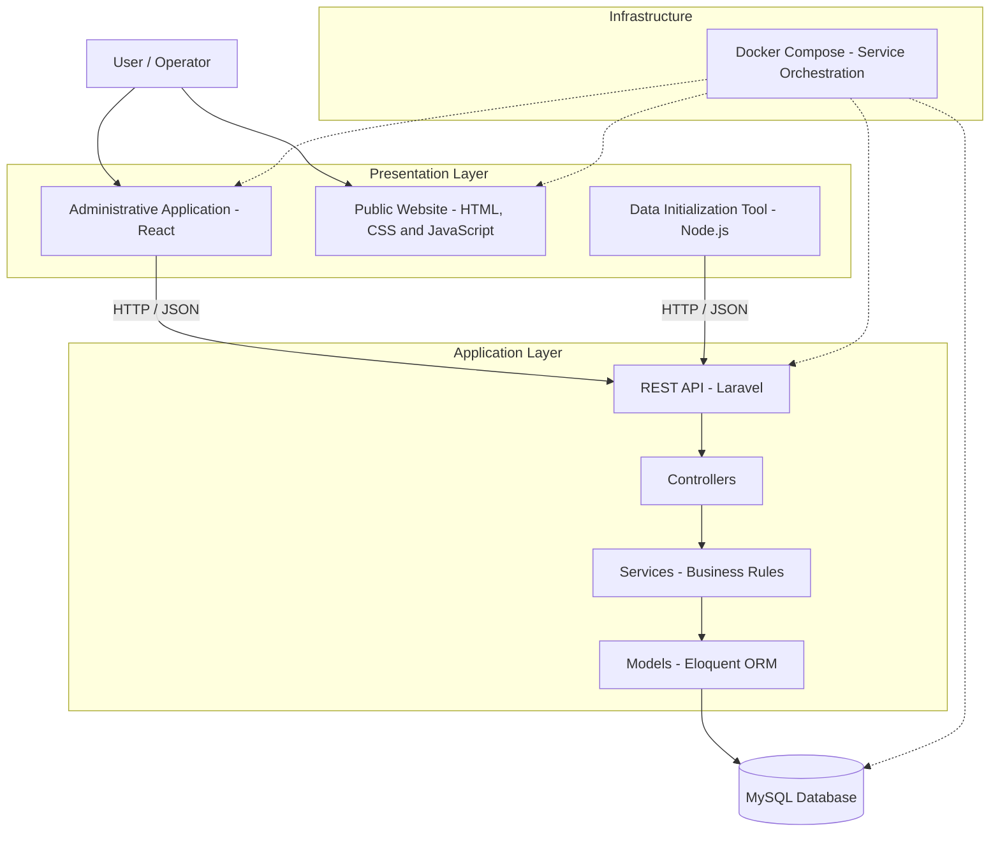

# System Architecture — Music School

**Identifier:** music-school  
**Project:** Musical Instrument Loan Management System  
**Training Group:** ADSO 3239137  
**Apprentice Code:** A12  
**Version:** 1.1  
**Status:** Draft for Validation

---

## 1. Purpose

This document describes the technical architecture of the Music School system, establishing the organization of its components, responsibilities, communication mechanisms, and infrastructure distribution.

The architecture defines how the frontend, backend, database, and other components required to manage musical instrument loans and returns will be integrated.

Its design must comply with the principles established in `constitution.md` and the functional requirements, business rules, and non-functional requirements defined in `spec.md`.

## 2. Architectural Objective

Define an organized, maintainable, and secure architecture that enables Music School to be developed using components with independent responsibilities and centralized communication through a REST API.

## 3. Architectural Style

The system will use a client-server architecture with a layered separation of responsibilities.

The following main components will be established:

- **Frontend:** Web application developed with React.
- **Backend:** Application developed with PHP and Laravel.
- **Persistence:** MySQL database.
- **Public Website:** Static page used to present the product.
- **Infrastructure:** Services configured using Docker.
- **Data Initialization Tool:** Data seeding mechanism through the API.

The backend will use a layered organization to separate API presentation, business logic, and data access responsibilities.

## 4. Main Components

### 4.1. Frontend — React

**Technology:** React.

**Responsibility:**

Provide the user interface for interacting with the system's features.

**Main Functions:**

- View the instrument catalog.
- View available units.
- Manage student information.
- Register loans.
- Register returns.
- View overdue loans.
- View transaction history.
- View inventory.
- Display the most requested instruments report.

**Implementation Rules:**

- Consume the endpoints defined in `api-contract.md`.
- Send HTTP requests to the backend.
- Display user-facing messages in Spanish.
- Keep presentation logic separate from business rules.
- Do not access the database directly.

### 4.2. Backend — PHP and Laravel

**Technology:** PHP with Laravel.

**Responsibility:**

Centralize business logic, validate operations, and control data access.

**Main Functions:**

- Manage instruments and categories.
- Manage students.
- Register loans.
- Register returns.
- Control loan due dates.
- Validate inventory availability.
- Preserve historical information.
- Generate the most requested instruments report.
- Control simultaneous operations.
- Provide HTTP and JSON responses.

**Internal Organization:**

The backend will be organized into the following layers:

**Controllers**

Receive HTTP requests, validate initial input, invoke the corresponding logic, and return responses.

**Services**

Contain business rules and coordinate system operations.

**Models**

Represent entities and enable interaction with persistence through Laravel Eloquent.

**Migrations**

Define database table structures, relationships, and constraints.

**Routes**

Define the endpoints available for communication with the frontend and authorized tools.

### 4.3. Database — MySQL

**Technology:** MySQL.

**Responsibility:**

Store and preserve system information while ensuring data integrity.

**Main Entities:**

- `categories`
- `instruments`
- `students`
- `loans`
- `returns`

**Persistence Responsibilities:**

- Preserve instrument categories.
- Register instruments and their units.
- Store student information.
- Preserve registered loans.
- Register returns.
- Maintain relationships between entities.
- Apply integrity constraints.
- Preserve historical transaction information.

The database structure must correspond to the definitions established in `data-model.md`.

#### Data Access and Schema Management

Laravel will use Eloquent ORM to interact with the MySQL database through models representing the entities defined in `data-model.md`.

Eloquent models will allow the system to retrieve, create, update, and relate entity records, preventing controllers from directly accessing the database.

Laravel migrations will define the physical structure of database tables, their columns, primary keys, foreign keys, constraints, and required indexes.

The main tables will be:

- `categories`
- `instruments`
- `students`
- `loans`
- `returns`

The structure implemented through migrations must remain consistent with the data model documented in `docs/data-model.md`.

Therefore, `data-model.md` will serve as the logical design reference, while Laravel migrations will provide the mechanism for creating and maintaining the MySQL database schema.

### 4.4. Static Public Website

**Technology:** Static web technologies.

**Responsibility:**

Present the Music School product through an informative public website.

The page must describe the system's purpose and main features.

It will not replace the functional application or perform loan or return operations.

### 4.5. Infrastructure — Docker

**Technology:** Docker and Docker Compose.

**Responsibility:**

Enable the integrated execution of the services required by the project.

The infrastructure will include:

- Backend service.
- Frontend service.
- MySQL database service.
- Service or configuration required to display the static public website.

Services must be configured to start with a single command, according to the deployment requirement.

### 4.6. Data Seeding Tool

**Responsibility:**

Facilitate the initialization of test data through API endpoints.

The tool must prepare the data required to validate system features without directly modifying the database outside the established mechanisms.

The initial data must include the five instrument categories defined in `spec.md`.

## 5. Logical Architecture

Communication between components will follow this flow:



The frontend will not have direct access to MySQL. All retrieval and modification operations must be performed through backend endpoints.

The static public website will be an independent component used to present the product.

## 6. Main Operation Flows

### 6.1. Loan Registration

1. The frontend sends a loan request to the backend.
2. Laravel receives and validates the input data.
3. The loan service verifies that the student exists and complies with the loan rules.
4. A database transaction is started.
5. The instrument record is retrieved and locked using `lockForUpdate()`.
6. After acquiring the lock, the system verifies that the instrument is active and has available units.
7. Student restrictions are checked again before registering the operation.
8. The loan is registered with the corresponding historical information.
9. Available units are decreased by one.
10. The transaction is committed using `commit()`.
11. The response is returned to the frontend.

If any validation fails, the operation must be canceled using `rollback()` without improperly modifying data.

If no units are available, the backend must return HTTP `409 Conflict`.

### 6.2. Return Registration

1. The frontend sends the return request.
2. Laravel identifies the corresponding loan.
3. The system verifies that the loan does not already have a registered return.
4. A transaction is started.
5. The return is registered with its date and time in UTC.
6. Available units of the instrument are increased.
7. The system verifies that available units do not exceed total units.
8. The transaction is committed.
9. The response is returned to the frontend.

The original loan information must remain unchanged.

### 6.3. Concurrency Control

#### Loan Concurrency Control

When two operators simultaneously attempt to register a loan for the last available unit of an instrument, the backend must ensure that only one operation can succeed.

To achieve this, Laravel will execute the process within a database transaction and use row-level locking (`lockForUpdate()`) on the instrument record.

The procedure will be as follows:

1. Start a database transaction.
2. Retrieve the instrument and lock its record using `lockForUpdate()`.
3. After acquiring the lock, verify again that the instrument is active and has available units.
4. If units are available, register the loan and decrease available units by one.
5. Commit the transaction using `commit()`.
6. If no units are available, cancel the operation using `rollback()` and return HTTP `409 Conflict`.

Therefore, if two operators attempt to lend the last available unit at the same time, the first operation may succeed, while the second receives an HTTP 409 response, preventing inconsistent inventory quantities.

Availability validation must be performed after acquiring the lock, not before.

## 7. Security and Integrity Rules

The architecture must comply with the following guidelines:

- Business validations must be executed in the backend.
- Secrets and credentials must be managed through environment variables.
- Passwords, when applicable, must be stored using secure hashing mechanisms.
- Database access must be performed through the backend.
- Operations that modify inventory must be executed within transactions.
- Integrity constraints defined in `data-model.md` must be applied.
- Loans and returns must not be physically deleted.
- Removed instruments must be managed through logical deactivation.
- Historical data must preserve the original information of each operation.
- Dates and times must be stored and processed in UTC.
- User-facing messages must be written in Spanish.

## 8. Communication Contract

Communication between the frontend and backend will be performed through a REST API using HTTP and JSON.

The detailed communication contract will be documented in `api-contract.md`.

This document must define:

- Endpoints.
- HTTP methods.
- Input parameters.
- Request structures.
- Response structures.
- HTTP status codes.
- Validations and errors.

Responses must use the HTTP status codes corresponding to the outcome of each operation, including HTTP `409 Conflict` for availability conflicts defined in the business rules.

## 9. Infrastructure Organization

The infrastructure will be organized using Docker Compose to facilitate integrated project execution.

The planned structure will be:

```text
plan-mejoramiento/
│
├── api/                         # Laravel Backend
│
├── app/                         # React Frontend
│   ├── public/
│   └── src/
│       ├── assets/
│       ├── pages/
│       │   ├── Categories.jsx
│       │   ├── Students.jsx
│       │   ├── Loans.jsx
│       │   ├── Returns.jsx
│       │   └── Dashboard.jsx
│       ├── services/
│       │   ├── api.js
│       │   ├── categoryService.js
│       │   ├── instrumentService.js
│       │   ├── studentService.js
│       │   ├── loanService.js
│       │   ├── returnService.js
│       │   └── reportService.js
│       ├── App.jsx
│       ├── App.css
│       └── index.css
│
├── docs/                        # Technical Documentation
│   └── adr/                     # Architectural Decisions
│
├── infra/                       # Infrastructure
│   ├── docker-compose.yml
│   └── .env.example
│
├── page/                        # Static Public Website
│   ├── index.html
│   ├── styles.css
│   └── script.js
│
├── tool/                        # Data Initialization Tool
│   ├── src/
│   │   ├── api.js
│   │   ├── config.js
│   │   └── seed.js
│   ├── categories.json
│   ├── instruments.json
│   ├── package.json
│   └── README.md
│
├── .gitignore
└── README.md
```

The final configuration must correspond to the actual locations of each component's build and configuration files.

Services must use environment variables to configure credentials and connections.

The project must be executable using a single Docker Compose command.

#### Service Orchestration with Docker Compose

Docker Compose will be responsible for defining, configuring, and coordinating the services required to run Music School.

The configuration will include the following services:

- **Backend:** Application developed with PHP and Laravel, responsible for business logic and the REST API.
- **Frontend:** Application developed with React, responsible for the user interface.
- **Database:** MySQL, responsible for persistent data storage.
- **Public Website:** Static application used to present the product.

Docker Compose will allow the required service configurations, ports, environment variables, networks, and dependencies to be established.

The objective is to start the development environment with a single command:

`docker compose up -d`

The final service configuration will be defined in `infra/docker-compose.yml`.

## 10. Architectural Constraints

The solution must comply with the following constraints:

- The frontend must be developed using React.
- The backend must be developed using PHP and Laravel.
- Persistence must use MySQL.
- Communication between the frontend and backend must use a REST API.
- Data must be exchanged using JSON.
- Infrastructure must use Docker.
- Business rules must be centralized in the backend.
- Code identifiers must be written in English.
- User-facing messages must be written in Spanish.
- Features outside the scope established in `spec.md` must not be introduced.

## 11. Relationship with Other Documents

| Document | Architectural Relationship |
|---|---|
| `constitution.md` | Establishes the principles and constraints that the architecture must follow. |
| `spec.md` | Defines the features, business rules, and requirements that the system must support. |
| `plan.md` | Organizes the phases and activities required to design and implement the solution. |
| `data-model.md` | Defines the persistence structure and data relationships. |
| `api-contract.md` | Defines communication between the frontend and backend. |
| `tasks.md` | Breaks down implementation into the 23 established tasks. |
| `adr/` | Records architectural decisions and their justifications. |

## 12. Architectural Decisions

Relevant architectural decisions must be documented through Architecture Decision Records (ADRs).

At least three records must be prepared to document the decisions made, their contexts, alternatives, and justifications.

These records must be maintained in the `docs/adr/` directory.

## 13. Change Log

| Version | Date | Description | Status |
|---|---|---|---|
| 1.0 | 07/11/2026 | Initial creation of the Music School architecture document. | Draft for Validation |
| 1.1 | 08/11/2026 | Updated the logical architecture diagram, concurrency control description, Docker Compose infrastructure organization, data access through Eloquent and migrations, and directory structure. | Draft for Validation |
