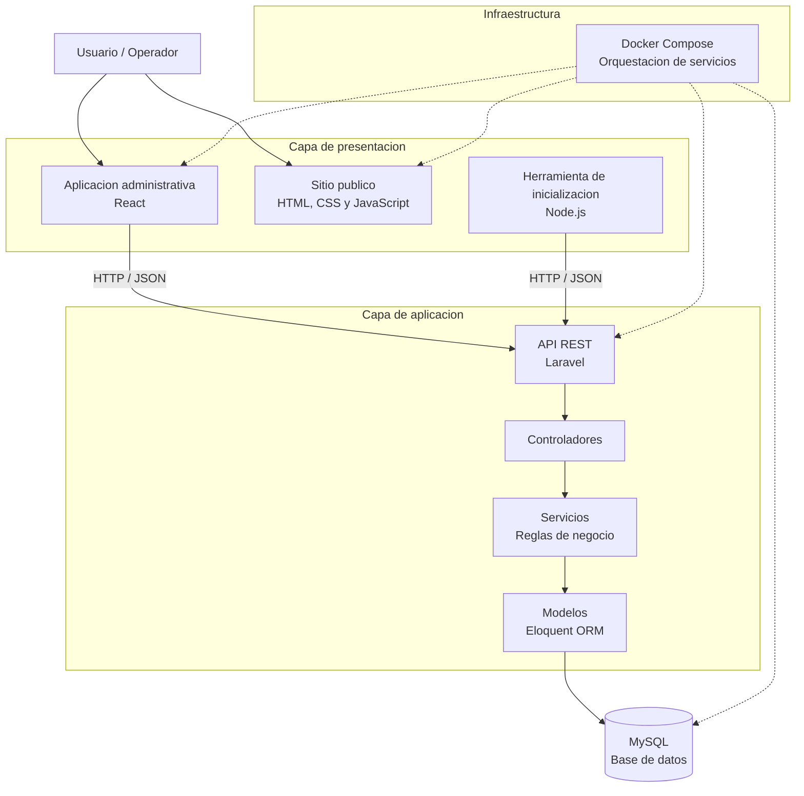

# Arquitectura del sistema — Music School

**Identificador:** music-school  
**Proyecto:** Sistema de prestamo de instrumentos musicales  
**Ficha:** ADSO 3239137  
**Codigo del aprendiz:** A12  
**Version:** 1.1
**Estado:** Borrador para validacion

---

## 1. Proposito

El presente documento describe la arquitectura tecnica del sistema Music School, estableciendo la organizacion de sus componentes, responsabilidades, mecanismos de comunicacion y distribucion de la infraestructura.

La arquitectura define como se integraran el frontend, backend, base de datos y demas componentes necesarios para gestionar el prestamo y devolucion de instrumentos musicales.

Su diseño debera respetar los principios establecidos en `constitution.md` y los requisitos funcionales, reglas de negocio y requisitos no funcionales definidos en `spec.md`.

## 2. Objetivo arquitectonico

Definir una arquitectura organizada, mantenible y segura que permita desarrollar Music School mediante componentes independientes en sus responsabilidades, con comunicacion centralizada a traves de una API REST.

## 3. Estilo arquitectonico

El sistema utilizara una arquitectura cliente-servidor con separacion de responsabilidades por capas.

Se estableceran los siguientes componentes principales:

- **Frontend:** aplicacion web desarrollada con React.
- **Backend:** aplicacion desarrollada con PHP y Laravel.
- **Persistencia:** base de datos MySQL.
- **Sitio publico:** pagina estatica para presentar el producto.
- **Infraestructura:** servicios configurados mediante Docker.
- **Herramienta de inicializacion:** mecanismo de siembra de datos mediante la API.

El backend utilizara una organizacion por capas para separar las responsabilidades de presentacion de la API, logica de negocio y acceso a datos.

## 4. Componentes principales

### 4.1. Frontend — React

**Tecnologia:** React.

**Responsabilidad:**

Proporcionar la interfaz de usuario para interactuar con las funcionalidades del sistema.

**Funciones principales:**

- Consultar el catalogo de instrumentos.
- Consultar las unidades disponibles.
- Gestionar la informacion de los estudiantes.
- Registrar prestamos.
- Registrar devoluciones.
- Consultar prestamos vencidos.
- Consultar el historial de operaciones.
- Consultar el inventario.
- Visualizar el reporte de instrumentos mas solicitados.

**Reglas de implementacion:**

- Consumir los endpoints definidos en `api-contract.md`.
- Enviar solicitudes HTTP al backend.
- Presentar mensajes de usuario en español.
- Mantener la logica de presentacion separada de las reglas de negocio.
- No acceder directamente a la base de datos.

### 4.2. Backend — PHP y Laravel

**Tecnologia:** PHP con Laravel.

**Responsabilidad:**

Centralizar la logica de negocio, validar las operaciones y controlar el acceso a los datos.

**Funciones principales:**

- Gestionar instrumentos y categorias.
- Gestionar estudiantes.
- Registrar prestamos.
- Registrar devoluciones.
- Controlar los vencimientos.
- Validar la disponibilidad del inventario.
- Conservar la informacion historica.
- Generar el reporte de instrumentos mas solicitados.
- Controlar las operaciones simultaneas.
- Proporcionar respuestas HTTP y JSON.

**Organizacion interna:**

El backend se organizara mediante las siguientes capas:

**Controladores (Controllers)**

Reciben las solicitudes HTTP, validan la entrada inicial, invocan la logica correspondiente y devuelven las respuestas.

**Servicios (Services)**

Contienen las reglas de negocio y coordinan las operaciones del sistema.

**Modelos (Models)**

Representan las entidades y permiten interactuar con la persistencia mediante Laravel Eloquent.

**Migraciones (Migrations)**

Definen la estructura de las tablas, relaciones y restricciones de la base de datos.

**Rutas (Routes)**

Definen los endpoints disponibles para la comunicacion con el frontend y las herramientas autorizadas.

### 4.3. Base de datos — MySQL

**Tecnologia:** MySQL.

**Responsabilidad:**

Almacenar y conservar la informacion del sistema, garantizando la integridad de los datos.

**Entidades principales:**

- `categories`
- `instruments`
- `students`
- `loans`
- `returns`

**Responsabilidades de persistencia:**

- Conservar las categorias de instrumentos.
- Registrar los instrumentos y sus unidades.
- Almacenar la informacion de los estudiantes.
- Conservar los prestamos realizados.
- Registrar las devoluciones.
- Mantener las relaciones entre las entidades.
- Aplicar las restricciones de integridad.
- Preservar la informacion historica de las operaciones.

La estructura de la base de datos debera corresponder con lo definido en `data-model.md`.

#### Acceso a datos y gestion del esquema

Laravel utilizara Eloquent ORM para interactuar con la base de datos MySQL mediante modelos que representan las entidades definidas en `data-model.md`.

Los modelos Eloquent permitiran consultar, crear, actualizar y relacionar los registros de las entidades del sistema, evitando que los controladores accedan directamente a la base de datos.

Las migraciones de Laravel definiran la estructura fisica de las tablas, sus columnas, claves primarias, claves foraneas, restricciones e indices necesarios.

Las tablas principales seran:

- `categories`
- `instruments`
- `students`
- `loans`
- `returns`

La estructura implementada mediante las migraciones debera mantener correspondencia con el modelo de datos documentado en `docs/data-model.md`.

De esta manera, `data-model.md` sera la referencia del diseño logico y las migraciones Laravel seran el mecanismo para construir y mantener el esquema de la base de datos MySQL.

### 4.4. Sitio publico estatico

**Tecnologia:** tecnologias web estaticas.

**Responsabilidad:**

Presentar el producto Music School mediante una pagina publica informativa.

La pagina debera describir el proposito del sistema y sus principales caracteristicas.

No reemplazara la aplicacion funcional ni realizara operaciones de prestamo o devolucion.

### 4.5. Infraestructura — Docker

**Tecnologia:** Docker y Docker Compose.

**Responsabilidad:**

Permitir la ejecucion integrada de los servicios requeridos por el proyecto.

La infraestructura contemplara:

- Servicio del backend.
- Servicio del frontend.
- Servicio de base de datos MySQL.
- Servicio o configuracion necesaria para presentar el sitio publico estatico.

Los servicios deberan configurarse para iniciar mediante un solo comando, de acuerdo con el requisito de despliegue.

### 4.6. Herramienta de siembra de datos

**Responsabilidad:**

Facilitar la inicializacion de informacion de prueba mediante los endpoints de la API.

Debera permitir preparar los datos necesarios para validar las funcionalidades del sistema sin modificar directamente la base de datos por fuera de los mecanismos establecidos.

La informacion inicial debera contemplar las cinco categorias de instrumentos definidas en `spec.md`.

## 5. Arquitectura logica

La comunicacion entre los componentes seguira el siguiente flujo:

El frontend no tendra acceso directo a MySQL. Todas las operaciones de consulta y modificacion deberan realizarse mediante los endpoints del backend.

El sitio publico estatico sera un componente independiente de presentacion del producto.

## 6. Flujo de las operaciones principales

### 6.1. Registro de prestamos

1. El frontend envia la solicitud de prestamo al backend.
2. Laravel recibe y valida los datos de entrada.
3. El servicio de prestamos verifica que el estudiante exista y cumpla las reglas de prestamo.
4. Inicia una transaccion en la base de datos.
5. Consulta y bloquea el registro del instrumento mediante `lockForUpdate()`.
6. Despues de adquirir el bloqueo, verifica que el instrumento este activo y tenga unidades disponibles.
7. Comprueba nuevamente las restricciones del estudiante antes de registrar la operacion.
8. Registra el prestamo con la informacion historica correspondiente.
9. Disminuye las unidades disponibles en una unidad.
10. Confirma la transaccion mediante `commit()`.
11. Devuelve la respuesta al frontend.

Si alguna validacion falla, la operacion debera cancelarse mediante `rollback()`, sin modificar indebidamente los datos. Si no hay unidades disponibles, el backend respondera con HTTP 409 Conflict.

### 6.2. Registro de devoluciones

1. El frontend envia la solicitud de devolucion.
2. Laravel identifica el prestamo correspondiente.
3. Verifica que el prestamo no tenga una devolucion registrada.
4. Inicia una transaccion.
5. Registra la devolucion con fecha y hora UTC.
6. Incrementa las unidades disponibles del instrumento.
7. Comprueba que las unidades disponibles no superen el total.
8. Confirma la transaccion.
9. Devuelve la respuesta al frontend.

La informacion original del prestamo debera conservarse sin modificaciones.

### 6.3. Control de concurrencia
#### Control de concurrencia en los prestamos

Cuando dos operadores intentan registrar simultaneamente un prestamo de la ultima unidad disponible de un instrumento, el backend debe garantizar que solo una operacion pueda completarse.

Para ello, Laravel ejecutara el proceso dentro de una transaccion de base de datos y utilizara un bloqueo de fila (`lockForUpdate()`) sobre el registro del instrumento.

El procedimiento sera el siguiente:

1. Iniciar una transaccion en la base de datos.
2. Consultar el instrumento y bloquear su registro mediante `lockForUpdate()`.
3. Una vez adquirido el bloqueo, verificar nuevamente que el instrumento este activo y tenga unidades disponibles.
4. Si existe disponibilidad, registrar el prestamo y disminuir las unidades disponibles en una unidad.
5. Confirmar la transaccion mediante `commit()`.
6. Si no hay unidades disponibles, cancelar la operacion mediante `rollback()` y responder con el codigo HTTP `409 Conflict`.

De esta manera, si dos operadores intentan prestar la ultima unidad al mismo tiempo, el primero podra completar la operacion y el segundo recibira una respuesta HTTP 409, evitando que el inventario quede con cantidades inconsistentes.

La validacion de disponibilidad debe realizarse despues de adquirir el bloqueo, no antes.

## 7. Reglas de seguridad e integridad

La arquitectura debera cumplir los siguientes lineamientos:

- Las validaciones de negocio deberan ejecutarse en el backend.
- Los secretos y credenciales deberan gestionarse mediante variables de entorno.
- Las contraseñas, cuando existan, deberan almacenarse mediante mecanismos seguros de hash.
- El acceso a la base de datos debera realizarse desde el backend.
- Las operaciones que modifiquen el inventario deberan ejecutarse mediante transacciones.
- Se deberan aplicar las restricciones de integridad definidas en `data-model.md`.
- Los prestamos y devoluciones no deberan eliminarse fisicamente.
- Los instrumentos retirados deberan manejarse mediante baja logica.
- Los datos historicos deberan conservar la informacion original de cada operacion.
- Las fechas y horas deberan almacenarse y procesarse en UTC.
- Los mensajes visibles para el usuario deberan estar en español.

## 8. Contrato de comunicacion

La comunicacion entre frontend y backend se realizara mediante una API REST utilizando HTTP y JSON.

El contrato detallado de comunicacion se documentara en `api-contract.md`.

Este documento debera definir:

- Endpoints.
- Metodos HTTP.
- Parametros de entrada.
- Estructuras de solicitudes.
- Estructuras de respuestas.
- Codigos de estado HTTP.
- Validaciones y errores.

Las respuestas deberan utilizar los codigos HTTP correspondientes al resultado de cada operacion, incluyendo HTTP 409 Conflict para los conflictos de disponibilidad definidos en las reglas de negocio.

## 9. Organizacion de la infraestructura

La infraestructura se organizara mediante Docker Compose para facilitar la ejecucion integrada del proyecto.

La estructura prevista sera:

plan-mejoramiento/
│
├── api/                         # Backend Laravel
│
├── app/                         # Frontend React
│   ├── public/
│   └── src/
│       ├── assets/
│       ├── pages/
│       │   ├── Categories.jsx
│       │   ├── Students.jsx
│       │   ├── Loans.jsx
│       │   ├── Returns.jsx
│       │   └── Dashboard.jsx
│       ├── services/
│       │   ├── api.js
│       │   ├── categoryService.js
│       │   ├── instrumentService.js
│       │   ├── studentService.js
│       │   ├── loanService.js
│       │   ├── returnService.js
│       │   └── reportService.js
│       ├── App.jsx
│       ├── App.css
│       └── index.css
│
├── docs/                        # Documentacion tecnica
│   └── adr/                     # Decisiones arquitectonicas
│
├── infra/                       # Infraestructura
│   ├── docker-compose.yml
│   └── .env.example
│
├── page/                        # Sitio publico estatico
│   ├── index.html
│   ├── styles.css
│   └── script.js
│
├── tool/                        # Herramienta de inicializacion
│   ├── src/
│   │   ├── api.js
│   │   ├── config.js
│   │   └── seed.js
│   ├── categories.json
│   ├── instruments.json
│   ├── package.json
│   └── README.md
│
├── .gitignore
└── README.md

La configuracion definitiva debera corresponder con la ubicacion real de los archivos de construccion y configuracion de cada componente.

Los servicios deberan utilizar variables de entorno para la configuracion de credenciales y conexiones.

La ejecucion del proyecto debera realizarse mediante un solo comando de Docker Compose.

#### Orquestacion de servicios con Docker Compose

Docker Compose sera el encargado de definir, configurar y coordinar los servicios necesarios para ejecutar Music School.

La configuracion contemplara los siguientes servicios:

- **Backend:** aplicacion desarrollada con PHP y Laravel, responsable de la logica de negocio y la API REST.
- **Frontend:** aplicacion desarrollada con React, responsable de la interfaz de usuario.
- **Base de datos:** MySQL, encargado del almacenamiento persistente de la informacion.
- **Sitio publico:** aplicacion estatica destinada a presentar el producto.

Docker Compose permitira establecer las configuraciones, puertos, variables de entorno, redes y dependencias necesarias entre los servicios.

El objetivo es que el entorno de desarrollo pueda iniciarse mediante un unico comando:

`docker compose up -d`

La configuracion definitiva de los servicios se establecera en el archivo `infra/docker-compose.yml`.

## 10. Restricciones arquitectonicas

La solucion debera respetar las siguientes restricciones:

- El frontend se desarrollara utilizando React.
- El backend se desarrollara utilizando PHP y Laravel.
- La persistencia utilizara MySQL.
- La comunicacion entre frontend y backend se realizara mediante API REST.
- Los datos se intercambiaran mediante JSON.
- La infraestructura utilizara Docker.
- Las reglas de negocio se centralizaran en el backend.
- Los identificadores del codigo se escribiran en ingles.
- Los mensajes visibles para el usuario se escribiran en español.
- No se introduciran funcionalidades fuera del alcance establecido en `spec.md`.

## 11. Relacion con los demas documentos

| Documento | Relacion arquitectonica |
|---|---|
| `constitution.md` | Establece los principios y restricciones que debe respetar la arquitectura. |
| `spec.md` | Define las funcionalidades, reglas de negocio y requisitos que debe soportar. |
| `plan.md` | Organiza las fases y actividades para diseñar e implementar la solucion. |
| `data-model.md` | Define la estructura de persistencia y las relaciones de datos. |
| `api-contract.md` | Define la comunicacion entre frontend y backend. |
| `tasks.md` | Descompone la implementacion en las 23 tareas establecidas. |
| `adr/` | Registra las decisiones arquitectonicas y sus justificaciones. |

## 12. Decisiones arquitectonicas

Las decisiones relevantes de arquitectura deberan documentarse mediante registros ADR (Architecture Decision Records).

Se deberan elaborar al menos tres registros que documenten las decisiones adoptadas, sus contextos, alternativas y justificaciones.

Los registros deberan mantenerse en el directorio `docs/adr/`.

## 13. Control de cambios

| Version | Fecha | Descripcion | Estado |
|---|---|---|---|
| 1.0 | 07/11/2026 | Creacion inicial del documento de arquitectura de Music School. | Borrador para validacion |
| 1.1 | 08/11/2026 | Actualizacion del diagrama de arquitectura logica, descripcion del control de concurrencia, organizacion de infraestructura Docker Compose, acceso a datos mediante Eloquent y migraciones, y estructura de directorios. | Borrador para validacion |