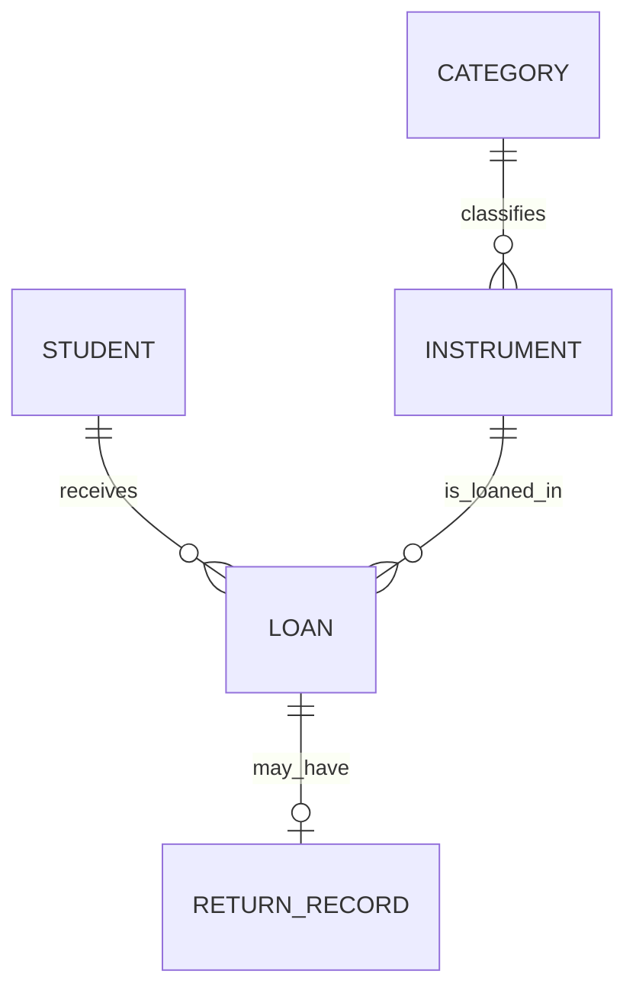

# Data Model — Music School

**Identifier:** music-school  
**Project:** Musical Instrument Loan Management System  
**Training Group:** ADSO 3239137  
**Apprentice Code:** A12  
**Version:** 1.3
**Status:** Draft for Validation

---

## 1. Purpose

This document defines the conceptual, logical, and physical data models of the Music School system. It describes the domain entities and their relationships, then specifies their attributes, data types, primary keys, foreign keys, constraints, indexes, and implementation in MySQL and Laravel.

The data model will serve as a reference for implementing data persistence using MySQL and Laravel.

Its design must ensure information integrity, inventory control, preservation of transaction history, and consistency of loans and returns.

## 2. Persistence Technology

| Element | Technology |
|---|---|
| Database Engine | MySQL 8 |
| Persistence Backend | PHP with Laravel |
| Identifiers | English |
| Dates and Times | UTC |
| Referential Integrity | Foreign Keys |
| Operation Control | Database Transactions |

## 3. Main Entities

The model includes the following entities:

- `categories`: Stores instrument categories.
- `instruments`: Stores instrument models and their quantities.
- `students`: Stores student information.
- `loans`: Records loans that are pending return, including overdue loans, or have been returned, and preserves historical data.
- `returns`: Records returns associated with loans.

## 4. Conceptual Data Model

### 4.1. Purpose and Domain Scope

The conceptual model describes the main domain entities of Music School and the relationships required to manage instrument categories, instrument models, students, loans, and returns.

An instrument represents a model or type of musical instrument. Its physical units are represented as quantities belonging to that model; individual physical units are not separate entities in this specification. Each loan represents one unit of an instrument model.

The model contains five entities: `Category`, `Instrument`, `Student`, `Loan`, and `Return`. Their domain meaning and identifying information are summarized below. Detailed columns, data types, keys, indexes, and database constraints are defined in the logical and physical model sections that follow.

| Entity | Domain meaning | Identifying and descriptive information |
|---|---|---|
| `Category` | A classification used to organize instrument models. | Category code, name, and active status. |
| `Instrument` | A musical instrument model managed by the school, including its inventory quantities. | Instrument code, name, total units, available units, and active status. |
| `Student` | A student who may request instrument loans. | Student code, full name, and email address. |
| `Loan` | A transaction recording one instrument model unit lent to one student. | Loan identifier, student and instrument snapshots, loan date, and due date. |
| `Return` | The recorded return associated with a loan. | Return identifier and return date and time. |

### 4.2. Conceptual Relationships and Cardinalities

The minimum and maximum cardinalities below describe participation in the domain model. The rule limiting a student to one unreturned loan is a business constraint over time; it does not change the historical one-to-many relationship between students and loans.

| Relationship | Cardinality from the first entity | Cardinality from the second entity | Meaning |
|---|---:|---:|---|
| `Category` — `Instrument` | One `Category` has 0..* `Instruments`. | Each `Instrument` belongs to exactly 1 `Category`. | A category may exist before instruments are assigned to it; an instrument must have a category. |
| `Student` — `Loan` | One `Student` has 0..* historical `Loans`. | Each `Loan` belongs to exactly 1 `Student`. | A student may have no loans or multiple loans over time. |
| `Instrument` — `Loan` | One `Instrument` appears in 0..* historical `Loans`. | Each `Loan` refers to exactly 1 `Instrument` model. | An instrument model may never have been loaned or may appear in many loan records. |
| `Loan` — `Return` | One `Loan` has 0..1 `Return`. | Each `Return` belongs to exactly 1 `Loan`. | A loan may still be pending, or it may have one recorded return. |

### 4.3. Conceptual Entity-Relationship Diagram

The diagram represents only the five domain entities, their relationships, and their cardinalities. `RETURN_RECORD` is the diagram node name for the conceptual entity `Return`; its implementation correspondence is described in Section 4.5.



### 4.4. Business Rules Associated with the Conceptual Model

| Entity or relationship | Specification rule | Model interpretation |
|---|---|---|
| `Student` — `Loan` | RN-01 | A student may have at most one unreturned loan at a time, while retaining multiple loan records over time. |
| `Loan` | RN-02 | A loan is due 21 days after its registration. It is overdue when its due date has passed and it has no associated return. |
| `Instrument` — `Loan` — `Return` | RN-03 | A loan decreases available units by one, and a return increases them by one. Available units must remain between zero and total units. |
| `Category` — `Instrument`, `Instrument` — `Loan`, and `Loan` — `Return` | RN-04 | Loan records and their student and instrument snapshots, as well as return records, are preserved. Instruments use logical deactivation; category activation and deactivation follow the extension and pending-loan restriction stated in the current specification. |
| `Instrument` — `Loan` | RN-05 | Concurrent loans must not allocate the same last available unit twice; a request that cannot obtain the unit returns HTTP `409 Conflict`. |
| `Loan` — `Return` and transaction dates | RN-06 | Transaction dates and times are handled in UTC. User-facing text is in Spanish. |

A student may accumulate multiple historical loans, but a new loan is not permitted while that student has an unreturned loan. The pending, returned, and overdue states are derived from the loan due date and the existence of its associated return; they are not separate entities. User-facing language is an application concern specified by RN-06, not a database entity.

### 4.5. Correspondence Between Conceptual, Logical, and Physical Models

| Conceptual element | Logical representation | Physical implementation |
|---|---|---|
| `Category` | Category code, name, and active status. | `categories`; generated `id` primary key and unique `code`. `is_active` is added by `2026_11_10_000000_add_is_active_to_categories_table.php`. `Category` has many `Instrument` records. |
| `Instrument` | Instrument model, category membership, inventory quantities, and active status. | `instruments`; `category_id` foreign key, unique `code`, unsigned `total_units` and `available_units`, and `chk_instruments_inventory`. `Instrument` belongs to a `Category` and has many `Loan` records. |
| `Student` | Student identity and contact information. | `students`; generated `id`, unique `student_code`, and unique `email`. `Student` has many `Loan` records. |
| `Loan` | A loan links one student to one instrument model and preserves the transaction-time snapshots and dates. | `loans`; `student_id` and `instrument_id` foreign keys, snapshot columns, `loaned_at`, `due_at`, and the documented indexes. `Loan` belongs to a `Student` and an `Instrument`, and has zero or one `ReturnRecord`. |
| `Return` | A return records the date and time associated with one loan. | `returns`; `loan_id` is a unique foreign key and `returned_at` stores the return time. Laravel represents this table with the `ReturnRecord` model, which belongs to one `Loan`. |

The conceptual model defines the domain entities and their relationships. The logical model in the following sections specifies attributes, keys, and integrity rules. Laravel migrations implement the physical MySQL tables and constraints, while Eloquent models represent the entities and relationships in application code.

## 5. Entity Definitions

### 5.1. `categories` Table

Stores musical instrument categories.

| Field | Data Type | Constraint | Description |
|---|---|---|---|
| id | BIGINT UNSIGNED | PK, AUTO_INCREMENT | Category identifier. |
| code | VARCHAR(20) | UNIQUE, NOT NULL | Category code. |
| name | VARCHAR(100) | NOT NULL | Category name. |
| is_active | BOOLEAN | NOT NULL, DEFAULT TRUE | Category status for logical activation and deactivation. |
| created_at | TIMESTAMP | NULLABLE | Creation date in UTC. |
| updated_at | TIMESTAMP | NULLABLE | Last update date in UTC. |

Constraints:

- Categories must be active by default.
- Category codes must be unique.
- Categories must support logical activation and deactivation using the `is_active` field.
- Categories with instruments associated with pending loans cannot be deactivated.
- Inactive categories cannot be used for new instrument registrations or loans.
- Inactive categories cannot be assigned during instrument updates.
- Categories can be reactivated without creating new records.
- Logical deactivation must preserve existing relationships and historical records.

Initial categories:

| Code | Category |
|---|---|
| CAT-01 | Cuerdas |
| CAT-02 | Vientos |
| CAT-03 | Percusion |
| CAT-04 | Teclados |
| CAT-05 | Electronicos |

### 5.2. `instruments` Table

Stores musical instrument models and their quantities.

| Field | Data Type | Constraint | Description |
|---|---|---|---|
| id | BIGINT UNSIGNED | PK, AUTO_INCREMENT | Instrument identifier. |
| category_id | BIGINT UNSIGNED | FK, NOT NULL | Associated category. |
| code | VARCHAR(30) | UNIQUE, NOT NULL | Unique model code. |
| name | VARCHAR(150) | NOT NULL | Instrument name. |
| total_units | INT UNSIGNED | NOT NULL | Total number of units. |
| available_units | INT UNSIGNED | NOT NULL | Number of available units. |
| is_active | BOOLEAN | NOT NULL, DEFAULT TRUE | Instrument status for logical deactivation. |
| created_at | TIMESTAMP | NULLABLE | Creation date in UTC. |
| updated_at | TIMESTAMP | NULLABLE | Last update date in UTC. |

Constraints:

- `total_units` must be greater than or equal to zero.
- `available_units` must be greater than or equal to zero.
- `available_units` must not exceed `total_units`.
- Inactive instruments cannot be included in new loans.
- Deactivated instruments must preserve their historical records.
- Deactivating an instrument must not physically delete its record.
- Instruments must belong to an active category when registered or updated.
- Instruments belonging to inactive categories cannot be included in new loans.
- Category activation or deactivation must not modify the individual `is_active` status of associated instruments.

### 5.3. `students` Table

Stores student information.

| Field | Data Type | Constraint | Description |
|---|---|---|---|
| id | BIGINT UNSIGNED | PK, AUTO_INCREMENT | Student identifier. |
| student_code | VARCHAR(30) | UNIQUE, NOT NULL | Student code. |
| full_name | VARCHAR(150) | NOT NULL | Full name. |
| email | VARCHAR(150) | UNIQUE, NOT NULL | Email address. |
| created_at | TIMESTAMP | NULLABLE | Creation date in UTC. |
| updated_at | TIMESTAMP | NULLABLE | Last update date in UTC. |

Constraints:

- Each student must have a unique identifier.
- Student codes must not be duplicated.
- Student information associated with historical loans must be preserved through snapshot data recorded for each operation.

### 5.4. `loans` Table

Stores registered loans and preserves the original student and instrument information at the time of each operation.

| Field | Data Type | Constraint | Description |
|---|---|---|---|
| id | BIGINT UNSIGNED | PK, AUTO_INCREMENT | Loan identifier. |
| student_id | BIGINT UNSIGNED | FK, NOT NULL | Associated student. |
| instrument_id | BIGINT UNSIGNED | FK, NOT NULL | Associated instrument model. |
| student_code | VARCHAR(30) | NOT NULL | Student code at the time of the loan. |
| student_name | VARCHAR(150) | NOT NULL | Student name at the time of the loan. |
| instrument_code | VARCHAR(30) | NOT NULL | Instrument code at the time of the loan. |
| instrument_name | VARCHAR(150) | NOT NULL | Instrument name at the time of the loan. |
| loaned_at | DATETIME | NOT NULL | Loan date and time in UTC. |
| due_at | DATETIME | NOT NULL | Due date and time in UTC. |
| created_at | TIMESTAMP | NULLABLE | Record creation date in UTC. |
| updated_at | TIMESTAMP | NULLABLE | Last update date in UTC. |

Constraints:

- Each loan must belong to an existing student.
- Each loan must correspond to an existing instrument.
- Each loan represents one unit of an instrument model.
- The due date must be set to 21 days after the loan registration date.
- A student cannot have more than one loan pending return.
- Students with overdue and unreturned loans cannot receive new instruments.
- Snapshot data must preserve the original student and instrument information.
- Loans must not be physically deleted.
- Historical records must not be modified by subsequent changes to the catalog or student information.
- New loans require an active instrument belonging to an active category.

**Loan Status Identification:**

Loan status shall be determined by the existence of a related record in the `returns` table.

- If no associated return exists, the loan remains pending.
- If an associated return exists, the loan is considered returned.
- If no return exists and `due_at` has passed, the loan is considered overdue.

This mechanism avoids maintaining a duplicated status field that could cause inconsistencies with return records.

### 5.5. `returns` Table

Stores instrument returns.

| Field | Data Type | Constraint | Description |
|---|---|---|---|
| id | BIGINT UNSIGNED | PK, AUTO_INCREMENT | Return identifier. |
| loan_id | BIGINT UNSIGNED | FK, UNIQUE, NOT NULL | Returned loan. |
| returned_at | DATETIME | NOT NULL | Return date and time in UTC. |
| created_at | TIMESTAMP | NULLABLE | Record creation date in UTC. |
| updated_at | TIMESTAMP | NULLABLE | Last update date in UTC. |

Constraints:

- Each return must be associated with an existing loan.
- Each loan may have at most one return.
- Duplicate returns are not allowed.
- Returns must not be physically deleted.
- A return must increase the available units of the corresponding instrument.
- Available units must never exceed total units.
- The return must preserve the historical information of its associated loan.

## 6. Relationships Between Entities

| Main Entity | Relationship | Related Entity |
|---|---|---|
| categories | 1:N (category has 0..* instruments; each instrument has exactly 1 category) | instruments |
| instruments | 1:N (instrument has 0..* historical loans; each loan has exactly 1 instrument) | loans |
| students | 1:N (student has 0..* historical loans; each loan has exactly 1 student) | loans |
| loans | 1:0..1 (loan has 0..1 return; each return has exactly 1 loan) | returns / `ReturnRecord` |

Relationship descriptions:

- A category may contain multiple instrument models.
- An instrument may be associated with multiple historical loans.
- A student may have multiple loans over time while respecting the limit of one pending loan.
- A loan may have zero or one registered return. The conceptual entity is `Return`; it is stored in the `returns` table and represented by Laravel's `ReturnRecord` model.

## 7. Integrity Rules

1. Foreign keys must ensure referential integrity.
2. Available units must remain between zero and total units.
3. A student cannot have more than one loan pending return.
4. A student with an overdue and unreturned loan cannot receive another instrument.
5. Each loan must have a 21-day period.
6. A return must be associated with an existing loan.
7. A loan cannot have more than one return.
8. Loans and returns must be preserved as historical records.
9. Snapshot data must preserve the original information of each operation.
10. Instruments removed from the catalog must use logical deactivation.
11. Simultaneous operations must protect inventory availability.
12. Dates and times must be stored and processed in UTC.
13. Categories must support logical activation and deactivation.
14. Categories with instruments associated with pending loans cannot be deactivated.
15. Instruments belonging to inactive categories cannot be included in new loans.
16. Category activation and deactivation must preserve existing relationships and historical records.

## 8. Implemented Indexes

| Table | Index | Purpose |
|---|---|---|
| categories | UNIQUE(code) | Retrieve categories by code. |
| instruments | UNIQUE(code) | Identify instrument models. |
| instruments | category_id, is_active | Retrieve instruments by category and active status. |
| students | UNIQUE(student_code) | Search students by code. |
| students | UNIQUE(email) | Prevent duplicate email addresses. |
| loans | student_id, due_at | Retrieve student loans and support overdue validations. |
| loans | instrument_id, loaned_at | Retrieve historical instrument loans. |
| returns | UNIQUE(loan_id) | Prevent duplicate returns. |

Primary keys, UNIQUE constraints, and foreign keys also generate or require indexes according to MySQL rules.

## 9. Implementation Considerations

### 9.1. Loan Control

Loan registration must be executed within a database transaction.

The following steps must be performed within the transaction:

1. Verify that the student exists.
2. Lock the student row during loan validation to prevent two simultaneous requests from registering pending loans for the same student.
3. Verify that the student has no other pending loan.
4. Verify that the student has no overdue and unreturned loans.
5. Lock the row of the instrument to be lent.
6. Verify that the instrument is active and belongs to an active category.
7. Verify that available units exist.
8. Register the loan and its snapshot data.
9. Decrease available units by one.
10. Commit the transaction.

Pending loan validation must be performed within the same transaction that registers the new loan.

To accomplish this, Laravel must lock the student row using pessimistic locking (`lockForUpdate()`), check whether the student has a loan without a registered return, and, if none exists, register the new loan and update inventory.

The lock must remain active until the transaction ends through a commit or rollback.

This prevents two simultaneous requests from creating pending loans for the same student.

### 9.2. Return Control

Returns must be executed within a database transaction.

The following steps must be performed within the transaction:

1. Identify the loan.
2. Lock the loan row during the return operation.
3. Verify that no return has already been registered.
4. Register the return.
5. Increase the available units of the instrument associated with the loan by one.
6. Verify that available units do not exceed total units.
7. Commit the transaction.

### 9.3. Concurrency Control

To prevent two operators from simultaneously lending the last available unit of an instrument:

- Database transactions must be used.
- The instrument row must be locked during the loan operation.
- Availability must be verified within the transaction.
- Updating available units and registering the loan must occur within the same transaction.
- If another operator has already registered the loan for the last available unit, the operation must be rejected.
- The rejected operation must return HTTP `409 Conflict`.
- When an operation is rejected, no loan must be created and available units must remain unchanged.
- If an error occurs during the operation, a `ROLLBACK` must be executed to prevent partial changes.
- If the operation completes successfully, a `COMMIT` must be executed.

### 9.4. Referential Integrity and Record Deletion

To ensure information integrity and preserve loan history:

- Relationships between tables must be implemented using foreign keys.
- Physical deletion of students with registered loans must not be allowed.
- Physical deletion of instruments with associated loans must not be allowed.
- Foreign keys must use the `ON DELETE RESTRICT` constraint when appropriate.
- Instruments must be removed from the catalog through logical deactivation using the `is_active` field.
- Loans and returns must be permanently preserved to maintain transaction traceability.
- Categories must support logical activation and deactivation using the `is_active` field.
- Categories with associated pending instrument loans cannot be deactivated.
- Category deactivation must preserve existing instruments, relationships, and historical loan records.
- Reactivating a category must not create duplicate records or modify the individual active status of its instruments.

### 9.5. Inventory Integrity Constraints

The database must ensure that the quantities recorded for each instrument maintain inventory consistency.

The following constraints must be applied:

- `total_units` must be greater than or equal to zero.
- `available_units` must be greater than or equal to zero.
- `available_units` must not exceed `total_units`.
- Available units must decrease when a loan is successfully registered.
- Available units must increase when a return is successfully registered.
- Operations that modify quantities must be executed within transactions.
- Constraints must be validated in both Laravel and the database.

In MySQL 8, `CHECK` constraints must be used to reinforce inventory conditions:

```sql
ALTER TABLE instruments
ADD CONSTRAINT chk_instruments_inventory
CHECK (available_units <= total_units);
```

The `total_units` and `available_units` columns use unsigned integers to prevent negative values.

The `chk_instruments_inventory` constraint is added through a dedicated Laravel migration using an `ALTER TABLE` statement.

These database constraints reinforce inventory integrity and complement backend validations.

## 10. Data Model Acceptance Criteria

The data model shall be considered acceptable when it meets the following conditions:

1. The five main entities exist: `categories`, `instruments`, `students`, `loans`, and `returns`.
2. Relationships between entities are defined using primary and foreign keys.
3. The initial categories correspond to the five categories established for the project.
4. Available units remain between zero and total units.
5. Loans preserve historical student and instrument data.
6. Each loan has a 21-day period.
7. Each loan may have at most one registered return.
8. Loans and returns preserve their historical information.
9. Instruments removed from the catalog are managed through logical deactivation.
10. Loan and return operations use transactions to maintain inventory integrity.
11. Concurrency control prevents the last available unit from being lent to two operators and returns HTTP `409 Conflict` when applicable.
12. Dates and times are stored and processed in UTC.
13. Defined indexes and constraints maintain consistency and facilitate system queries.
14. Categories support logical activation and deactivation through the `is_active` field.
15. Categories with pending instrument loans cannot be deactivated.
16. Instruments belonging to inactive categories cannot be included in new loans.
17. Category activation and deactivation preserve existing relationships and historical records.

## 11. Change Log

| Version | Date | Description |
|---|---|---|
| 1.0 | 07/11/2026 | Initial creation of the data model, including entity, attribute, and relationship definitions. |
| 1.1 | 07/11/2026 | Added implementation considerations, referential integrity, concurrency control, inventory constraints, and acceptance criteria. |
| 1.2 | 24/11/2026 | Documented logical category activation and deactivation, aligned historical field names, data types, indexes, and inventory constraints with Laravel migrations. |
| 1.3 | 25/11/2026 | Added an explicit conceptual model with domain entities, minimum and maximum cardinalities, a conceptual ER diagram, specification rule traceability, and correspondence with the logical and physical models. |

**Current Status:** Draft for Validation.
